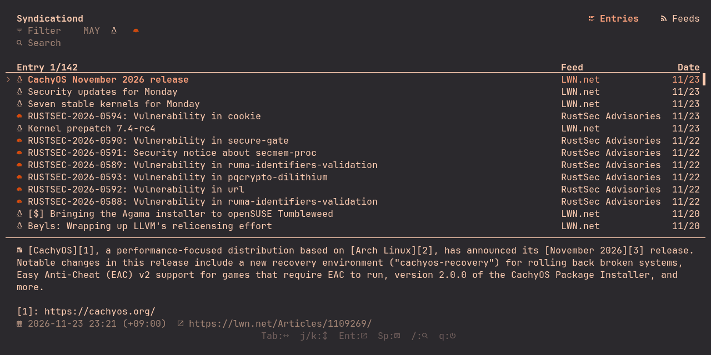
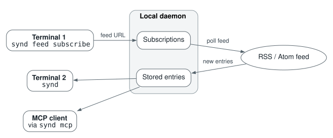

<div class="oranda-hide">

# Syndicationd

</div>

[![CI][workflow-ci-badge]][workflow-ci-url]
[![Release][workflow-release-badge]][workflow-release-url]
[![Audit][workflow-audit-badge]][workflow-audit-url]
[![Coverage][coverage-badge]][coverage-url]



Syndicationd is a TUI feed viewer, based on [feed-rs](https://github.com/feed-rs/feed-rs) and [ratatui](https://github.com/ratatui-org/ratatui).
It also provides a CLI and an MCP server.

## Installation

Install from crates.io:

```sh
cargo install synd --version 0.4.0 --locked
```

<details>
<summary>Other installation methods</summary>

### nix

```sh
nix profile add github:ymgyt/syndicationd/v0.4.0#synd
```

### homebrew

```sh
brew install ymgyt/syndicationd/synd
```

### shell

```sh
curl --proto '=https' --tlsv1.2 -LsSf https://github.com/ymgyt/syndicationd/releases/download/v0.4.0/synd-installer.sh | sh
```

### npm

```sh
npm install @syndicationd/synd@0.4.0
```

### powershell

```sh
powershell -ExecutionPolicy Bypass -c "irm https://github.com/ymgyt/syndicationd/releases/download/v0.4.0/synd-installer.ps1 | iex"
```

### docker

```sh
docker run --rm -it ghcr.io/ymgyt/synd:0.4.0
```

### pre-built binaries

Pre-built binaries are available in the
[`v0.4.0` GitHub release](https://github.com/ymgyt/syndicationd/releases/tag/v0.4.0).

### source

```sh
cargo install --git https://github.com/ymgyt/syndicationd/ synd
```

Use the source install to try the current `main` branch behavior before the next release.

</details>

> [!NOTE]
> Install a [Nerd Font](https://www.nerdfonts.com/) to display icons in the TUI.

Run `synd` to open the TUI.

[Default key bindings][keymap]\
[Configuration][configuration]

[keymap]: https://github.com/ymgyt/syndicationd/blob/main/docs/mdbook/src/keymap.md#default-key-bindings
[configuration]: https://github.com/ymgyt/syndicationd/blob/main/docs/mdbook/src/configuration.md

## Overview



Subscribe to a feed in one terminal, then open `synd` in another to read its entries.

## MCP

Configure your MCP client to launch `synd mcp` over stdio.

<details>
<summary>Add to Claude Code</summary>

```sh
claude mcp add synd -- synd mcp
```

</details>

## Agent skill

```sh
# skills
npx skills add -g ymgyt/syndicationd

# apm
apm install -g ymgyt/syndicationd
```
## Development

See
[CONTRIBUTING.md](https://github.com/ymgyt/syndicationd/blob/main/CONTRIBUTING.md)
to get started with development.

## Project Goals

* **Terminal-first feed reader**.
  Build a feed reader for terminal users. No recommendations, no curation, no behavior analysis.

* **Local storage by default**.
  Store subscriptions and feed state in SQLite by default.

* **Long-term maintenance**.
  Prefer simple designs and stable dependencies so the project can be maintained for years.

## License

This project is available under the terms of either the
[Apache 2.0 license](https://github.com/ymgyt/syndicationd/blob/main/LICENSE-APACHE)
or the
[MIT license](https://github.com/ymgyt/syndicationd/blob/main/LICENSE-MIT).

[workflow-ci-badge]: https://img.shields.io/github/actions/workflow/status/ymgyt/syndicationd/ci.yaml?style=for-the-badge&logo=github&label=CI
[workflow-ci-url]: https://github.com/ymgyt/syndicationd/actions/workflows/ci.yaml
[workflow-release-badge]: https://img.shields.io/github/actions/workflow/status/ymgyt/syndicationd/release.yml?style=for-the-badge&logo=github&label=Release
[workflow-release-url]: https://github.com/ymgyt/syndicationd/actions/workflows/release.yml
[workflow-audit-badge]: https://img.shields.io/github/actions/workflow/status/ymgyt/syndicationd/audit.yaml?style=for-the-badge&logo=github&label=Audit
[workflow-audit-url]: https://github.com/ymgyt/syndicationd/actions/workflows/audit.yaml
[coverage-badge]: https://img.shields.io/codecov/c/github/ymgyt/syndicationd?token=W1A93WSPEE&style=for-the-badge&logo=codecov&color=brightgreen
[coverage-url]: https://app.codecov.io/github/ymgyt/syndicationd
